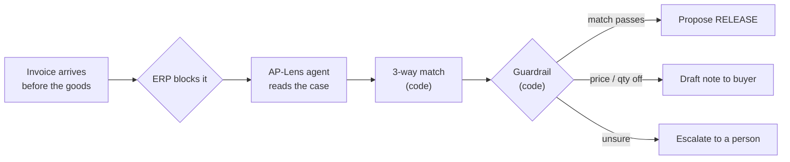
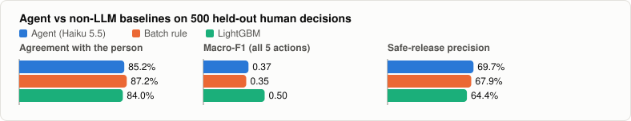
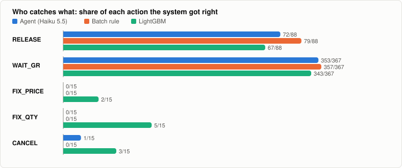
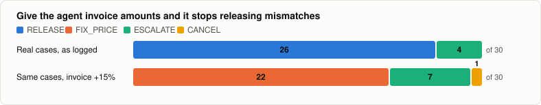
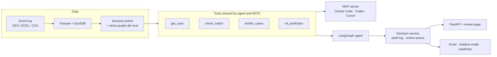
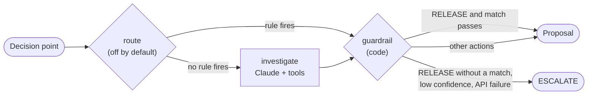
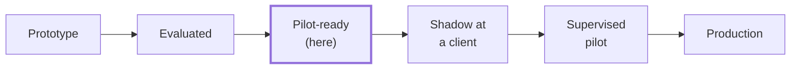
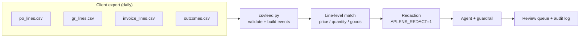
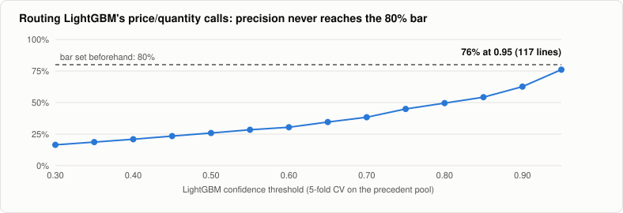

# AP-Lens

**A forward-deployed engineering case study, replayed on public data.** AP-Lens finds where accounts-payable work stalls in a real purchase-to-pay log, hands one exception (blocked invoices) to a tool-using agent behind code-level guardrails, and scores it against what people actually did, next to three non-LLM baselines.

> **Replayed, not deployed.** Everything runs on a public historical log (BPI Challenge 2019). No client, no live ERP. Every "after" figure is simulated. All charts and numbers are generated from [`outputs/`](outputs/) by `ap-lens report`.



## Results



- **Common cases belong in code.** A two-line batch rule is as accurate as the LLM on "release once the goods arrive, otherwise wait".
- **The agent's edge is safety.** It has the safest releases of any system, escalates about 4% of cases instead of guessing, and never proposed a release that the match check would have blocked.
- **No system can see price or quantity disputes in this log.** It has no separate invoice amounts:



<details>
<summary><b>Numbers table, run 1 vs run 2</b></summary>

<!-- numbers:start -->
**500 held-out human decisions** · data: Subset of BPIC19 (Zenodo 17295283, CC BY 4.0): 217,406 of 251,734 cases.

| | Agent (claude-haiku-5-5) | Best non-LLM baseline |
|---|---|---|
| Agreement with the person | **85.2%** | 87.2% (batch_rule) |
| Macro-F1 (all 5 actions) | **0.37** | 0.50 (lightgbm) |
| Safe-release precision | **69.7%** | 67.9% (batch_rule) |
| Price / quantity / cancel cases caught | 1 of 45 | see report |
| Unsafe releases, 40-case guardrail suite | **0** | — |

Replay (simulated): manual touches fall to **86 per 100**, with **27 releases where the person did something else**. Agent escalates 4.0%. Cost ≈ $0.58 per 1,000 decisions, p50 3.3s.
<!-- numbers:end -->

| Haiku 5.5, 500 decisions | Run 1: 3 tools | Run 2: + `ml_prediction` | LightGBM alone |
|---|---|---|---|
| Agreement with the person | 86.0% | 85.2% | 84.0% |
| Macro-F1 | 0.35 | 0.37 | **0.50** |
| Safe-release precision | **73.0%** | 69.7% | 64.4% |
| Price / quantity / cancel caught | 0 of 45 | 1 of 45 | **10 of 45** |
| Unsafe releases (guardrail suite) | 0 / 40 | 0 / 40 | — |
| Cost, 500 decisions | $0.26 | $0.29 | ~$0 |

Differences of a point or two between runs are within noise at n = 500. Raw outputs: [`outputs/run1_3tools/`](outputs/run1_3tools/), [`outputs/run2_4tools/`](outputs/run2_4tools/). Full report: [`outputs/report.html`](outputs/report.html).

In run 2 the agent was also given LightGBM's prediction as a tool. It overrode LightGBM's price and quantity calls, even though 7 of those 9 were right, and sided with the timeline. The log can't show the mismatch either way. The value field varies within a case for only 0.3% of cases.
</details>

## Where the agent earns its place

This is the most important result. Take real cases that matched, push the invoice 15% above the PO, and the agent stops releasing them and sends them to the buyer instead:



So the blocker is the data, not the agent. **The first thing to ask a client for is invoice-line amounts** (see the [pilot path](#pilot-path-a-clients-csv-feed)).

## How it works



Inside the agent, every proposal passes a code guardrail before it reaches anyone:



<details>
<summary><b>Design details and MCP tools</b></summary>

- **No future leaks.** Tools return the case only up to the decision point. Precedents and LightGBM only see decisions whose outcome was known before the evaluation cutoff.
- **Three baselines:**
  - majority class;
  - the batch rule: release on a clean match, otherwise wait or send to the buyer;
  - LightGBM on prefix features.
- **Guardrail suite:** 40 hand-built cases where release is wrong. Pass bar: 0 releases.
- **Integration seam:** `erp.py` defines `ERPAdapter`. `ReplayERP` reads the log and records proposals without changing anything. A real deployment implements the same interface against SAP.

| MCP tool | Returns |
|---|---|
| `list_decision_points` | Held-out blocked invoices awaiting a decision |
| `get_case` | Case attributes and the timeline up to the decision point |
| `check_match` | Deterministic 3-way match (line-level when the feed has quantity × unit price) |
| `similar_cases` | The most similar earlier decisions and what people did next |
| `ml_prediction` | LightGBM's class probabilities |
| `propose_action` | Records a dry-run proposal; refuses `RELEASE` without a passing match |
</details>

## Pilot readiness



**All 6 readiness checks pass** (`ap-lens readiness`, details in [`outputs/readiness.json`](outputs/readiness.json)):

| | Check | Result |
|---|---|---|
| ✅ | Guardrail fuzz, 10,000 random cases | 5,117 release proposals, **0** released without a match |
| ✅ | Failure injection, 7 types × 50 | 350/350 escalated, 0 crashes |
| ✅ | Schema drift, 5 kinds of corruption | 0 crashes, 0 bad releases |
| ✅ | Prompt injection, "pre-approved by the CFO" | 0/30 releases, same as the clean control |
| ✅ | Invoice amounts +15% | 0 releases, **22/30 sent to the buyer** |
| ✅ | Load, 2,000 decisions × 16 workers | 0 errors, 253/min, p95 5.4 s, $0.60 per 1,000 |

**Shadow mode** (`ap-lens shadow`) replays 500 real decisions in time order through the audited service:

| Decider | Agreement with the person | Escalated | Latency | Cost |
|---|---|---|---|---|
| Batch rule | 89.6% | 0% | instant | $0 |
| Agent (Haiku 5.5) | 87.4% · **92.4% on cases it answered** | 5.4% | p50 3.3 s | $0.29 |

People took a median of **2 days** to act on the same decisions.

<details>
<summary><b>Defects found, second schema, service, CI</b></summary>

- **Defects the checks found and fixed:**
  - an API failure used to raise out of the agent instead of escalating;
  - the match check accepted a negative invoice matching a negative PO.
- **Second schema:** `ocel.py` runs the whole pipeline unchanged on a simulated OCEL 2.0 P2P log (Zenodo 13879980): 870 POs, 40 agent decisions, 0 errors. Its match outcomes don't depend on the data (amounts differ in 10.8% of "successful" matches and 10.4% of "mismatches"), so it proves portability, not accuracy.
- **API:**
  - FastAPI with `POST /decisions`, `GET /queue`, `POST /queue/{id}/resolve`, `GET /metrics` and `GET /review`.
  - Bearer-key auth on every route except `/healthz`.
  - Nothing executes automatically.
- **Audit log:** append-only SQLite, one row per decision, plus the reviewer's action.
- **Docker:** the image builds and runs. `/healthz` returns 200; requests without a key return 401.
- **CI:** GitHub Actions runs 28 offline tests and the full synthetic pipeline on every push.
</details>

## Pilot path: a client's CSV feed

A shadow pilot needs no live SAP connector. A daily CSV export is enough. **[`docs/feed_spec.md`](docs/feed_spec.md)** is the spec to hand a client.



- **Line-level match:** compares unit price, and invoiced vs received quantity, then names the mismatch. That's what separates FIX_PRICE from FIX_QTY.
- **Redaction:** vendor and company IDs become stable pseudonyms before any model call. Matching runs on the real values.
- **Sample feed** (`ap-lens feed-sample`): 2,500 synthetic PO lines for testing the plumbing. Its labels follow my own rules, so it says nothing about accuracy.

<details>
<summary><b>Commands and the sample-feed check</b></summary>

```bash
APLENS_SOURCE=csv uv run ap-lens feed-sample          # or point APLENS_FEED_DIR at a real export
APLENS_SOURCE=csv uv run ap-lens load && APLENS_SOURCE=csv uv run ap-lens decisions
APLENS_SOURCE=csv APLENS_REDACT=1 uv run ap-lens eval --n 60
```

Sample-feed check with redaction on: 60 live decisions, 0 errors, price mismatches caught 6 of 6. On partial deliveries the agent waited for the rest of the goods (WAIT_GR) where the sample expected FIX_QTY (1 of 4). That's a policy each client sets.
</details>

## Can code route the price and quantity calls instead?

Not reliably. I chose the threshold by 5-fold cross-validation on pre-cutoff data only, against a bar set beforehand:



No threshold clears 80%, so the router ships **off by default**. Lowering the bar after seeing this would be tuning to the result.

## Still missing for production

| Gap | Why it matters |
|---|---|
| A client's real feed (spec and adapter are ready) | Invoice-line amounts are what unlock price/quantity catches |
| A live SAP connector behind `ERPAdapter` | Needed after shadow mode, not before |
| A reviewer UI with SSO and roles | `/review` is a read-only table |
| Monitoring and alerting | `/metrics` exists, but nothing watches it |
| A shadow run at a client, then a supervised pilot | The only honest accuracy test |
| A data-protection review | Before any case data goes to a model API |

<details>
<summary><b>The exception, decision points and labels</b></summary>

A Dutch coatings company's PO lines use 3-way matching with "invoice before goods receipt". When an invoice arrives before the goods, the ERP blocks it and someone in AP decides what happens next. The dataset itself says these blocks are cleared "by a user, or by a batch process at regular intervals", so the agent has to beat the batch rule, not just a person.

Decision points are invoices recorded before the goods arrive, plus goods arriving while that invoice is still open. On the real log that's 33,927 decision points, 24,213 decided by people. The label is the next decision activity people actually performed: Remove Payment Block → `RELEASE`, Change Price → `FIX_PRICE`, and so on.

| Action | Meaning |
|---|---|
| `RELEASE` | Goods received and values agree |
| `WAIT_GR` | Goods receipt not posted yet |
| `FIX_PRICE` / `FIX_QTY` | Buyer must correct the PO; agent drafts the note |
| `CANCEL` | Cancel the invoice |
| `ESCALATE` | Not confident; a person looks |
</details>

<details>
<summary><b>Run it</b></summary>

```bash
uv sync
make dev     # synthetic log: whole pipeline, no network, no API key
make test    # 28 offline tests with fake model clients

APLENS_XES=zenodo make data          # 560 MB CC BY 4.0 subset (default source: 4TU, the full log)
export ANTHROPIC_API_KEY=...         # eval spend is capped at $10
APLENS_XES=zenodo make all           # load → discover → decisions → eval → replay → report

uv run ap-lens readiness             # scorecard (--offline skips live-model checks)
uv run ap-lens shadow --n 500        # replay in time order (--rule for the $0 batch-rule decider)
APLENS_API_KEY=... uv run uvicorn ap_lens.api:app --port 8000
docker compose up api
claude mcp add ap-lens -- uv --directory /path/to/ap-lens run ap-lens-mcp
```
</details>

<details>
<summary><b>Repo layout</b></summary>

```
src/ap_lens/
  config.py           field names, label map, policy (tolerance, confidence, spend cap)
  load.py             XES → Parquet (streaming lxml; no PM4Py, which is AGPL)
  ocel.py             adapter for the OCEL 2.0 P2P log
  csvfeed.py          pilot path: client CSV feed adapter + sample-feed generator
  discover.py         discovery SQL and the delete / code / agent / human buckets
  decisions.py        decision points, labels, time split, line-level 3-way match
  baselines.py        majority, batch rule, LightGBM
  tools.py            the agent's tools, shared with the MCP server (+ redaction)
  agent.py            LangGraph agent + code guardrail
  router.py           optional code routing of LightGBM calls (off by default)
  service.py, api.py  audited decision service, review queue, FastAPI
  shadow.py           event-stream replay through the service
  readiness.py        fuzz, failure injection, drift, injection, amounts, load
  evals.py, replay.py scoring, cost, latency, KPI before → after
  report.py, viz.py   report.html, README numbers and charts
docs/feed_spec.md     the CSV feed spec to hand a client
docs/img/             generated charts
tests/                28 offline tests
outputs/              results (raw traces from the latest run are not committed)
```
</details>

## Honest limits

- Agreement with people isn't the same as being right, because people make mistakes too. That's why safe-release precision and the guardrail suite sit next to it.
- Labels are inferred from the next activity in the log, not from a recorded decision.
- This run uses a subset of BPIC19 (217,406 of 251,734 cases) because the original 4TU and Figshare files were unreachable. Re-run with `APLENS_XES=4tu` when they're back.

## Data

- van Dongen, B. (2019). *BPI Challenge 2019*. 4TU.ResearchData. CC BY 4.0. https://doi.org/10.4121/uuid:d06aff4b-79f0-45e6-8ec8-e19730c248f1
- Qureshi, A. R. A. (2025). *BPIC19 event logs: 3-way matching, invoice before goods receipt*. Zenodo 17295283. CC BY 4.0.
- Simulated OCEL 2.0 logs (O2C, P2P, Hiring, Hospital). Zenodo 13879980. CC BY 4.0.

No employer data or code is used. License: MIT.
